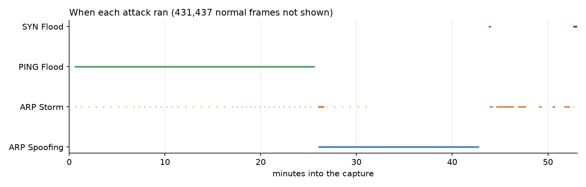

# Cyber Attack Dataset: ARP, SYN, PING Flood

[](https://github.com/aleksandar-rakic/cyber-attack-dataset-arp-syn-ping-flood/actions/workflows/ci.yml)
[](https://doi.org/10.34740/kaggle/ds/5620663)
[](https://www.kaggle.com/datasets/aleksandarraki/cyber-attack-dataset-arp-syn-ping-flood)

Code for version 3 of an open intrusion-detection dataset: one 53-minute lab capture of 439,171 network frames containing ARP spoofing, ARP storm, PING flood and SYN flood attacks.

The data itself (45 MB) is on [Kaggle](https://www.kaggle.com/datasets/aleksandarraki/cyber-attack-dataset-arp-syn-ping-flood). This repository holds the script that produced it, the baseline, two notebooks, a 25,000-row sample and the metadata.



## Why there is a version 3

Versions 1 and 2, and the [paper](https://infom.fon.bg.ac.rs/index.php/infom/article/view/2678) they were built for, published every column z-score standardized over all rows, in shuffled order. That made three problems invisible:

1. **Leakage through scaling.** The scaler saw the test rows before the train/test split.
2. **Leakage through the frame number.** The attacks ran in separate stretches of the capture (see the chart above), so the position of a frame alone predicts its class.
3. **Leakage through device identity.** The MAC address columns identify the attacking host.

With those in the feature set, any model scores about 1.000. That is what the earlier work reported, and it measures this capture, not the attacks.

Version 3 fixes the data rather than the documentation: original units, capture order, a chronological split, and the shortcut columns named so they can be left out.

## How the original values were recovered

The raw export of the normal traffic no longer exists, so the original values could not simply be re-exported. Standardization is an affine map per column, though, and the raw Wireshark exports of the four attacks survived. Every attack packet appears both in raw form and in standardized form, matched by frame number, which gives enough reference points to invert the map.

| Column | Method | Check |
|---|---|---|
| `frame_number` | affine fit on 7,734 attack packets | error below 1e-10; result is exactly 1 to 439,171 |
| `frame_time_delta` | affine fit on 7,734 attack packets | error below 1e-15 |
| `data_len` | affine fit on the three payload sizes in the SYN flood | most common normal payload: 1,480 bytes |
| `tcp_hdr_len` | anchored at 20 bytes, 4-byte level spacing | levels 20, 28, 32, 40, 44, 52 |
| `tcp_seq` | anchored at 0, unit refined by least squares | every value within 5e-7 of an integer |
| flags, `arp_opcode` | levels mapped back | match the raw captures on every attack row |

As a final check, standardizing the v3 table again reproduces the v1 table to within 1e-13 in every column. [`data/recovery_report.json`](data/recovery_report.json) has the fitted parameters.

One thing could not be recovered: the original ICMP type numbers of 258 normal packets. They are kept as codes 1 and 2.

## Baseline

Macro-F1 on the test rows, full dataset. Every fitted step sees the training rows only.

| Features | Split | Gradient boosting | Logistic regression |
|---|---|---:|---:|
| Header fields only | chronological | 0.953 | 0.953 |
| Header fields only | random stratified | 0.963 | 0.959 |
| Plus `frame_number` and device roles | chronological | 1.000 | 1.000 |
| Plus `frame_number` and device roles | random stratified | 1.000 | 1.000 |

On header fields alone the hard class is ARP storm: an ARP request from the attacker looks like any other ARP request.

## Evaluation traps notebook

[`notebooks/ids_evaluation_traps.ipynb`](notebooks/ids_evaluation_traps.ipynb) measures four ways an intrusion-detection score can mislead, one change at a time, on this dataset:

| Trap | Result here |
|---|---|
| Accuracy on imbalanced traffic | a model that never raises an alert: accuracy 0.982, macro-F1 0.198 |
| Shortcut features | frame number plus device roles: macro-F1 1.000 on any split |
| Shuffled split of time-ordered packets | ARP storm recall 1.000 on a random split, 0.809 on the chronological one |
| Preprocessing fitted on all rows (the v2 procedure) | 0.9525 vs 0.9527: negligible here, still wrong |

It needs the full table from Kaggle (`network_attack_traffic.csv`); it finds the file under `/kaggle/input` or anywhere below the working directory.

## Run it

```bash
pip install -r requirements.txt

# quick check on the sample in this repository
python src/baseline.py --data data/sample_25k.csv

# full baseline: download network_attack_traffic.csv from Kaggle first
python src/baseline.py --data network_attack_traffic.csv
```

`src/build_v3.py` rebuilds the release from the v1 table and the raw attack exports. Those inputs are not published because the raw exports carry device identifiers; the script is here so the method can be read and checked.

## Repository layout

```
src/build_v3.py         rebuilds v3 from v1 and the raw attack exports
src/baseline.py         baseline models, two feature sets, two splits
notebooks/              exploration and baseline; evaluation traps (both also on Kaggle)
data/sample_25k.csv     stratified sample in capture order
data/*.json, *.csv      column dictionary, label counts, recovery and QC reports
results/                baseline scores on the full dataset
```

## Limitations

- One capture, one network, one attacker. Do not expect the numbers to carry over to other networks.
- Each attack is a single header pattern, so per-packet classification is close to a lookup. Rate and window features over `frame_time_delta` are the more realistic task.
- "Normal" means "not exported as an attack". It includes the victim's responses during the attacks.

## Citation

```bibtex
@misc{rakic2026cyberattack,
  author    = {Raki{\'c}, Aleksandar},
  title     = {Cyber Attack Dataset: ARP, SYN, PING Flood},
  version   = {3},
  year      = {2026},
  publisher = {Kaggle},
  doi       = {10.34740/kaggle/ds/5620663}
}
```

Code is MIT licensed. Data is published on Kaggle under MIT.
